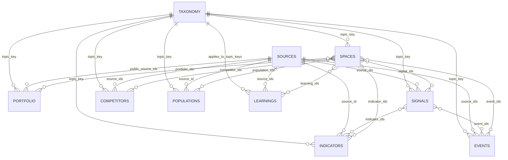

# Data guide — how to use the dataset

Everything is in [`../data/`](../data/): UTF-8 CSV, comma-delimited, header row, all values are strings.
**List cells use `|`** (e.g. `SRC026|SRC031`). **Empty = unknown / not supplied** — never zero, false or "low risk".

## 1. Data model



Two ways to join:
1. **By topic** — every table has `topic_key` (learnings: `applies_to_topic_keys`). Use it to build a topic dossier.
2. **By explicit IDs** — `*_ids` columns. `source_ids` / `source_id` always resolve to `08_sources.csv`.

## 2. ID prefixes

| Prefix | Table | Example | Notes |
|---|---|---|---|
| `F` | `01_portfolio.csv` | `F001` | F001–F036 organiser-supplied (original IDs); F037+ public observations |
| `L` | `02_learnings.csv` | `L012` | Public external precedents — **not** FACTS-internal history |
| `S`, `GS` | `03_signals.csv` | `S101`, `S215`, `GS003` | S001–S025 curated originals (unverified), GS derived hypotheses, S101–S123 original source-backed, S201+ research additions |
| `C` | `04_competitors.csv` | `C006`, `C057` | C001–C020 original, C021+ research additions |
| `I` | `05_market_indicators.csv` | `I0042` | One numeric observation (metric × geography × period) |
| `P` | `06_entity_populations.csv` | `P007` | Size of a potential target-entity universe |
| `R` | `07_regulatory_events.csv` | `R012` | Dated law/deadline/ruling/funding change |
| `SRC` | `08_sources.csv` | `SRC001`, `SRC145` | SRC001–SRC025 original, SRC026+ research additions |
| `M` | `09_opportunity_spaces.csv` | `M013` | Research starting points; M001–M012 = original contexts |

All original IDs are stable.

## 3. Tables

### 00_topic_taxonomy.csv
`topic_key`, `label`, `domain`, `ymyl_default` (yes / partial / no — use for human-review rules), `likely_facts_brand`, `description`.

### 01_portfolio.csv
| Column | Meaning |
|---|---|
| `project_id`, `project_name` (original), `project_name_en`, `brand`, `topic_key` | Identity |
| `status` | `current` / `to_validate` (organiser-supplied, undated) or `observed_public` (F037+) |
| `target_user`, `target_entity`, `consumer_problem`, `commercial_model`, `known_strengths`, `known_risks`, `ymyl` | Organiser context, translated |
| `public_first_edition`, `public_latest_edition`, `public_research_partner`, `public_methodology_note`, `public_seal_licensing`, `public_source_ids` | What public sources show about the product (empty = not found) |
| `record_origin`, `verification_status`, `status_note` | Provenance |

### 02_learnings.csv — precedents
`learning_id`, `date`, `title`, `actor`, `case_type` (court_ruling / regulator_action / product_discontinued / methodology_criticism /
public_reform / media_investigation), `what_happened` (fact), `lesson` (**interpretation**), `applies_to_topic_keys`, `involves_facts`
(yes = concerns FOCUS/FACTS products publicly), `risk_category`, `source_ids`, `learning_scope = public_external_record`.

> Use these to satisfy "consider historical learnings". They are public external precedents, not FACTS-internal project history.

### 03_signals.csv
`signal_id`, `topic_key`, `signal_type`, `title`, `summary` (the observation), `why_it_matters` (**curator hypothesis**), `geography`,
`period` (observation period), `direction`, `evidence_status`, `source_ids`, `indicator_ids`, `event_ids` (records sharing the source),
`supporting_signal_ids` (GS derivations), `limitation`, `original_language`, `title_de` (original German title), `origin`.

| `evidence_status` | Meaning |
|---|---|
| `source_backed_summary` | A cited source supports the summary (not every inference) |
| `curated_unverified` | Original organiser assertion without verified citation — context only |
| `derived_hypothesis` | Broad hypothesis built from other signals — not independent evidence |

### 04_competitors.csv
| Column | Values |
|---|---|
| `competitor_type` | media_ranking, seal_or_certification, review_platform, comparison_portal, lead_marketplace, official_register, public_information_service, professional_directory, consumer_test, association_award, other |
| `coverage` | national / regional / partial / unknown |
| `has_quality_assessment` | yes / no / partial / unknown — does it judge quality, or just list? |
| `has_seal_or_award` | yes / no / unknown |
| `provider_pays` | yes_listing_fee / yes_seal_license / yes_leads_commission / no / unknown — **evidence of a paid-visibility market** |
| `methodology_public` | yes / no / partial / unknown |
| `relationship_to_facts` | direct_competitor / existing_alternative / potential_partner / competitor_or_partner / relationship_unconfirmed / unknown |
| `observation` | What was observed (fact) |
| `gap_hypothesis` | Possible orientation gap (**hypothesis**) |

### 05_market_indicators.csv — numbers
Long format: one row per `metric` × `geography` × `period`. `value` is numeric; `unit` explains it (persons, count, EUR, EUR_bn,
percent, …). Filter by `metric` to get a time series:

```python
import csv
rows = list(csv.DictReader(open("data/05_market_indicators.csv", encoding="utf-8")))
series = sorted((r["period"], float(r["value"])) for r in rows if r["metric"] == rows[0]["metric"])
```
Different sources may use different definitions for similar metrics — check `note` before comparing.

### 06_entity_populations.csv — who could be assessed
`entity_type`, `count`, `period`, `definition`, `master_list_source` (which register/directory could seed a master list),
`master_list_availability` (public_register / chamber_directory / association_member_list / commercial_database / fragmented /
none_known), `source_id`. **A count is not a list** — the master list must still be built and checked.

### 07_regulatory_events.csv — timing
`event_date` (YYYY-MM-DD; month-level dates use day 01), `timing` (past / upcoming relative to 2026-11-09), `event_type`, `title`,
`jurisdiction`, `description` (fact), `implication_hypothesis` (**hypothesis**), `source_ids`.

### 08_sources.csv
`publisher`, `title`, `url` (attribution only — not needed at runtime), `publication_date`, `observation_period` (the period the data
describes), `source_type`, `review_method` (`page_review` = page/document text was read; `search_result_summary` = only the indexed
snippet was seen), `accessed_on`, `evidence_summary`, `limitations`, `language`, `origin`.

### 09_opportunity_spaces.csv
Curated research starting points with pre-linked evidence IDs, portfolio fit notes, commercial hypothesis
(`commercial_evidence_status` is always `plausible_but_unvalidated` or `unclear`), unknowns, feasibility notes, risks, next
questions and a `review_domain`. **Not ranked, not answers.** A strong solution evaluates them critically *and* finds others.

## 4. Evidence rules (short version)

1. Cite IDs; never invent IDs or numbers.
2. Keep observation periods: "5.7 m people in need of care (2023) `[I…]`".
3. Count corroboration by distinct **publishers** behind `source_ids`, not by rows (a source can appear in many tables).
4. `curated_unverified` / `derived_hypothesis` signals, `gap_hypothesis`, `implication_hypothesis`, `why_it_matters` and
   `lesson` are interpretations.
5. A register shows existence/admission, not quality. A count is not a master list. A competitor's existence is not a rejection.
6. Legal and medical summaries are context, not advice.

## 5. Retrieval helpers

- `evidence/corpus.jsonl` — one JSON object per record (`id`, `file`, `topic_key`, `text`, `metadata`), generated from the CSVs
  for embedding/RAG. It is a *view* of the CSVs, not additional evidence.
- `python3 scripts/validate_dataset.py` — integrity check (add `--build-corpus` after editing any CSV).
